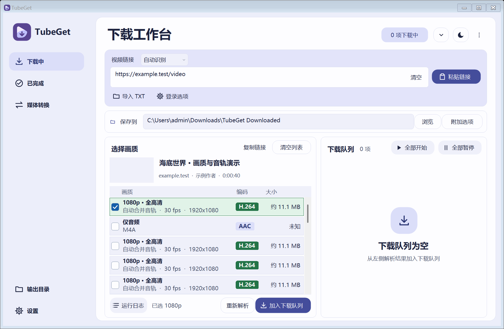
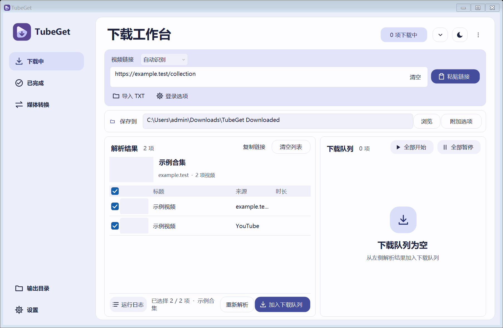
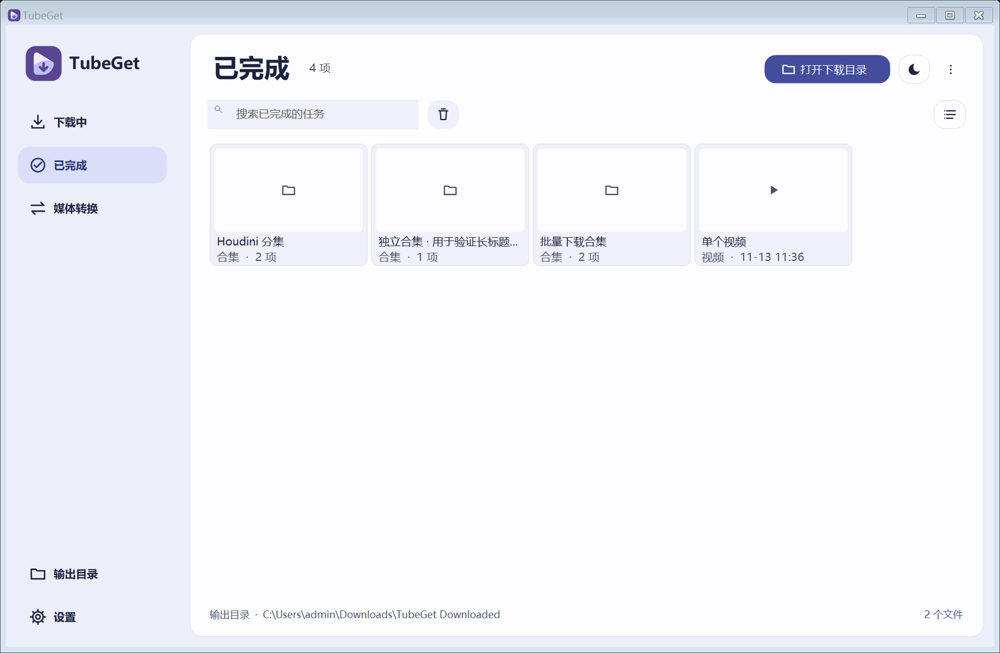
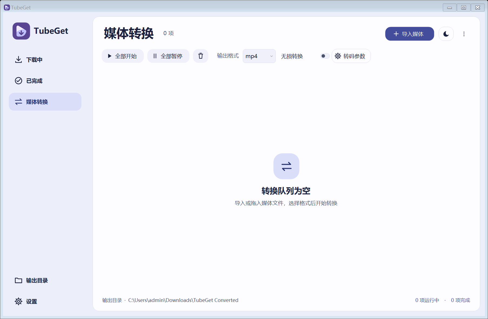
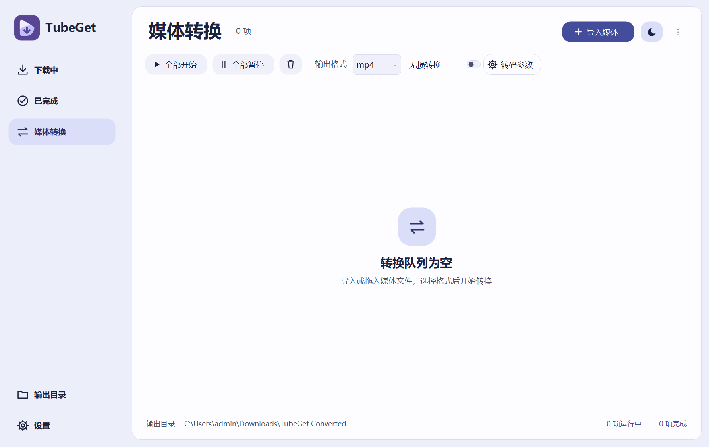
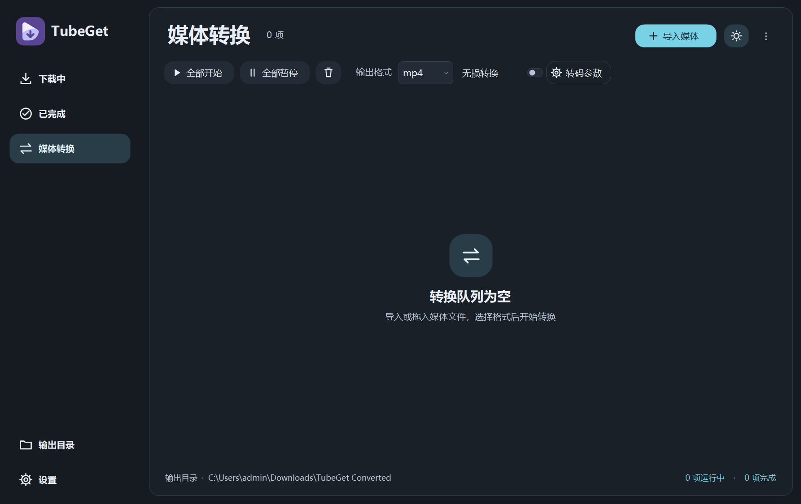

# TubeGet

适用于 64 位 Windows 10 和 11。TubeGet 可以解析作品链接、批量下载、管理已完成的文件，以及转换本地媒体。

[下载 Windows 安装包](https://github.com/Jugui-Lin/TubeGet/releases/latest/download/TubeGet-Setup.exe)

[启动程序](#启动程序) · [解析与下载](#解析与下载) · [查看已完成文件](#查看已完成文件) · [媒体转换](#媒体转换) · [站点登录](#站点登录) · [常见问题](#常见问题) · [程序更新](#程序更新) · [构建](#构建)

## 启动程序

- **安装向导版**。下载 `TubeGet-Setup.exe` 后双击安装。安装向导会把主程序和组件装入所选目录。安装后可从开始菜单启动，也可在 Windows 的「已安装的应用」中卸载。

各版本共用设置和任务历史，存放在 `%LOCALAPPDATA%\TubeGetDesktop`。如果手上只有 GitHub 源码，请先按[构建说明](#构建)准备组件并编译。

| 位置 | 内容 |
| --- | --- |
| 安装目录（默认 `%LOCALAPPDATA%\Programs\TubeGet`） | 主程序、内置组件和使用说明 |
| 数据目录（`⋯ → 数据文件夹`） | 设置、任务记录、登录会话及组件更新缓存 |
| 输出目录（工作台「保存到」及媒体转换设置） | 下载和转换后的媒体文件 |

## 解析与下载

**快速开始**：安装并启动 TubeGet → 粘贴作品链接 → 选择画质 → 加入下载队列。

### 下载单个作品

1. 复制作品页链接，在「下载中」点击「粘贴链接」。手动输入时，点「解析」或按 **Ctrl+Enter**。解析期间可点「取消解析」。
2. 在左侧结果中选择画质，或选择「仅音频」。分轨视频会显示是否自动合并音轨。需要指定音轨、字幕或封面时，打开「附加选项」。
3. 在「保存到」一栏确认目录，点击「加入下载队列」。任务加入右侧后，可通过「全部开始」和「全部暂停」管理队列，也可以单独暂停或重试任务。

### 下载合集或批量链接

- **合集、播放列表或频道**。粘贴合集或频道链接，勾选要下载的条目。表头复选框可全选或取消全选。合集和播放列表会保存到同名子文件夹。
- **多个独立链接**。在输入框粘贴多条链接，或点击「导入 TXT」。检查条目后批量加入队列，可按需设置画质上限和顺序编号。
- **只保存字幕或封面**。将解析模式切换到对应选项，按需设置字幕语言、格式和是否包含自动字幕。

顶部的「清空」只清除链接，保留解析结果和下载队列。左侧结果区的「清空列表」清除解析结果，保留输入链接。编辑链接时，上一份解析结果仍可查看，点「解析」后刷新。

## 查看已完成文件

切到「已完成」可搜索任务、查看列表或封面卡片。视图切换图标位于工具栏最右侧。双击合集可进入查看分集，合集里也能切换视图。点击「打开下载目录」可在资源管理器打开当前输出目录。

## 媒体转换

1. 打开「媒体转换」，点击「导入媒体」或拖入本地文件。
2. 选择输出格式。需要指定编码器、分辨率、码率或输出目录时，打开「转码参数」。
3. 点击「全部开始」。输出位置可在转换页底部查看。

「无损转换」会直接复制原有音视频码流，要求目标容器兼容源编码。右键任务可设置软字幕或硬字幕。对含视频画面的任务，可选「水印擦除」并在预览中圈选区域，程序会生成新文件。

## 站点登录

1. 先把作品链接填入下载工作台，再点「登录选项 → 去登录」。
2. 在应用内页面完成网站登录，然后点「已登录，获取 Cookies」。
3. 确认「Cookies 来源」为「应用内站点登录」，点击「确定」，再重新解析作品。新片场在使用默认设置时也会自动复用已保存的会话。

也可选择「自动读取 Edge」「自动读取 Chrome」或导入自己的 Cookies 文件。应用内登录使用 Microsoft Edge WebView2 Runtime。保存的站点会话由当前 Windows 用户加密保存在本机，视频密码仅在本次运行中使用。

## 常见问题

| 现象 | 处理方法 |
| --- | --- |
| 粘贴后解析失败 | 确认浏览器里能打开并播放该作品，复制具体作品页或分享链接。再点结果区底部的「运行日志」查看错误和处理建议。 |
| 提示需要登录，或无法读取浏览器 Cookies | 用「登录选项 → 去登录」重新保存应用内会话，再解析。使用浏览器 Cookies 时，可完全退出浏览器后重试，或改用 Cookies 文件。 |
| 有画质选项，但下载报 403 | 确认当前账号能在浏览器播放该画质，检查 TubeGet 与浏览器的代理设置，再重新开始任务。新片场 2160p 请使用包含下载修复的新版。 |
| 抖音精选、B 站空间或 Behance 解析异常 | 抖音复制具体作品链接。B 站空间可登录后重试。Behance 内嵌的 Vimeo 若要求登录，先在浏览器确认播放，再读取该浏览器的 Cookies。 |
| 怀疑解析组件版本过旧 | 打开「设置 → 组件 → 检查并更新」。更新完成后重新解析，或者重新开始失败的任务。 |

「运行日志」窗口支持复制日志和暂停滚动。右键队列中的任务可打开「查看任务日志」。解析或下载失败后，日志会显示对应的处理建议。反馈时请附上站点、任务阶段和脱敏日志。程序和组件版本可在「⋯ → 关于 TubeGet」复制。

## 程序更新

打开右上角「⋯ → 检查程序更新」，可从 GitHub 下载较新的稳定版。也可在「设置 → 常规」开启「启动时自动检查并下载程序更新」。下载通过 SHA-256 校验后，可在任务结束后确认安装并重启。程序更新会保留设置和任务历史。手动下载可查看进度或取消。

## 设置和托盘

- 点击右上角的外观图标可切换浅色和深色。「设置 → 常规 → 外观模式」支持浅色、深色和跟随系统。也可在常规设置关闭主题切换动画。
- 开启「关闭窗口时最小化到托盘」后，关窗会隐藏主窗口。右键托盘图标选「显示主窗口」可返回，选「退出 TubeGet」可结束程序。
- 「设置 → AI 修复」默认关闭。支持 OpenAI API、火山方舟 API、Codex、Ollama 和自定义本地程序。选择服务后先「测试连接」。提供给模型的是用于诊断的站点类型和错误分类等信息。修复后请检查解析结果，再手动加入下载队列。

查看浅色和深色主题

| 默认浅色 | 默认深色 |
| --- | --- |
|  |  |

组件版本、来源及许可证见[第三方组件清单](Windows/components/第三方组件.md)。截图使用示例任务展示操作位置，实际可选画质和格式以站点返回为准。

## 构建

按[第三方组件清单](Windows/components/第三方组件.md)准备各组件，将 x64 WebView2 SDK 的 Core、WinForms 和 Loader DLL 放到 `Windows/` 目录。运行 `Windows/源码/build.ps1` 编译。

制作带安装向导的 `TubeGet-Setup.exe` 时，运行 `Windows/源码/build-installer.ps1`。用 `-ProgramDirectory` 指定编译后的 `Windows` 程序目录，用 `-Compiler` 指定 Inno Setup 的 `ISCC.exe`，可用 `-OutputDirectory` 指定输出位置。添加 `-Verify` 可在打包前运行功能自测与界面检查，保存日志和截图，打包后核对版本并生成 `SHA256SUMS.txt`。如果编译器的 `Languages` 目录里缺少 `ChineseSimplified.isl`，可从 [Inno Setup 官方翻译页面](https://jrsoftware.org/inno-setup/translations)下载简体中文文件。

发布前核对发布标签、安装包和 EXE 的版本，验证全新安装及覆盖升级，确认 GitHub 发布页包含 `TubeGet-Setup.exe`，再从上一个已安装版本验证更新入口。对涉及的站点和画质，在发布说明写明实测范围。

[浏览 Windows 源码](Windows/源码)
